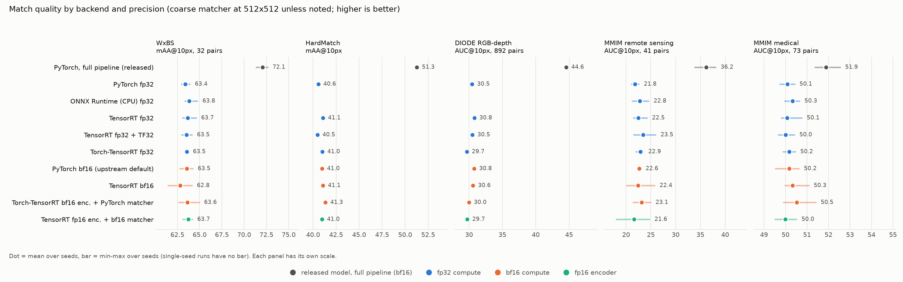
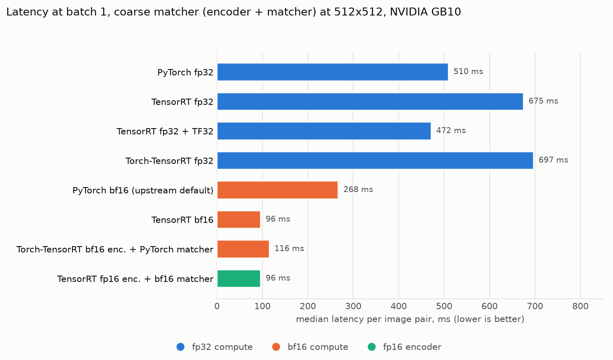
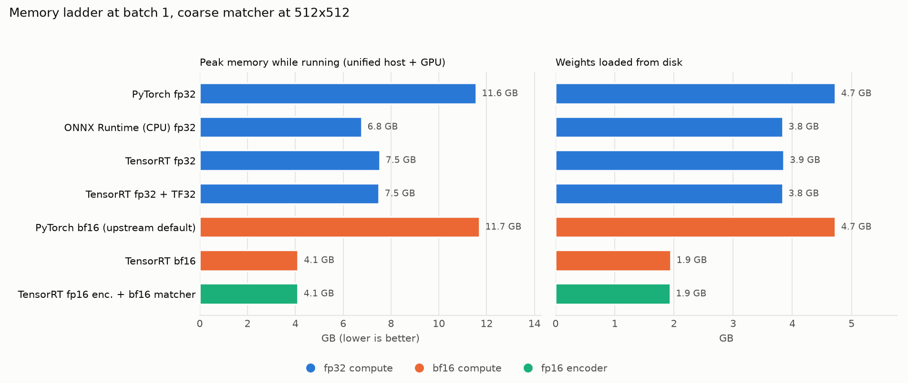

# RoMa-Ω: ONNX and TensorRT deployment

Export of the RoMa-Ω coarse matcher (frozen VGGT-Ω encoder + matcher head) to ONNX
and TensorRT, with an accuracy, latency and memory comparison against the released
PyTorch model.

> **This is deployment code for an existing model, not a new one.** The model, the
> weights and the paper are the work of the RoMa-Ω authors:
> *RoMa-Ω: What Feed-Forward 3D Models Know About Image Matching*, by David
> Nordström, Xinyue Zhang, Thibaut Loiseau, Vincent Lepetit and Fredrik Kahl
> ([paper](https://arxiv.org/abs/2609.09507),
> [original repository](https://github.com/davnords/RoMa-Omega)). See
> [Credits](#credits).

This repository contains only the deployment code, in [`deployment/`](deployment/).
The original RoMa-Ω code is not copied here: it is included unmodified as a git
submodule ([`RoMa-Omega/`](https://github.com/davnords/RoMa-Omega), pinned to
commit `24c693a`).

**Result in one line:** the bf16 TensorRT engines run the coarse matcher in 96 ms
per image pair on an NVIDIA GB10 (DGX Spark), 2.8x faster than upstream PyTorch
bf16 (268 ms), with 2.8x less peak memory, and match quality within seed noise on
five datasets.

| | |
|---|---|
| Hardware | NVIDIA DGX Spark (GB10, aarch64, CUDA 13, unified memory) |
| Software | torch 2.13.0+cu130, onnx 1.23.2, onnxscript 0.7.2, onnxruntime 1.31.1 (CPU), TensorRT 11.4.0.106; Torch-TensorRT 2.13.0 with TensorRT 11.0.0.114 in a separate environment |
| Upstream | RoMa-Omega `24c693a`, vggt-omega submodule `39a0cb8` |
| Export | dynamo (`torch.export`) ONNX exporter, opset 18, static shape, batch 1, 512x512 |

## Scope

What is exported is the **coarse matcher** in the upstream `fast` setting (512x512,
one direction): two graphs, `encoder.onnx` (VGGT-Ω aggregator, image pair in, two
feature maps out) and `matcher.onnx` (features in, warp and confidence out).

The refiners are **not** exported. The released model's headline numbers use the
full pipeline (`precise`: 800 px coarse, 1280 px refinement, bidirectional), so the
coarse rows below are compared with each other, and the full pipeline is shown only
as a reference point. The gap between them is the cost of leaving out the refiners
and the higher resolution, not of the export.

Upstream stores fp32 weights and computes under bf16 autocast. Three precisions are
exported: `fp32`, `bf16` (the upstream compute precision) and `fp16`.

## Accuracy

Coarse matcher at 512x512, 2000 sampled matches. WxBS and HardMatch are the
upstream benchmarks (mAA@10px); DIODE and MMIM follow the
[MINIMA](https://github.com/LSXI7/MINIMA) homography protocol (AUC@10px). Values are
mean ± standard deviation over 5 seeds where a deviation is shown, otherwise one
seed. The seed changes match sampling and the robust estimator, not the network.

| Backend | Precision | WxBS | HardMatch | DIODE RGB-depth | MMIM remote | MMIM medical |
|---|---|---|---|---|---|---|
| *PyTorch, full pipeline (released)* | bf16 | 72.07 ± 0.54 | 51.28 | 44.58 | 36.19 ± 1.86 | 51.89 ± 0.49 |
| PyTorch (upstream default) | bf16 | 63.55 ± 0.62 | 40.97 | 30.78 | 22.63 ± 0.34 | 50.17 ± 0.45 |
| PyTorch | fp32 | 63.40 ± 0.38 | 40.57 | 30.46 | 21.80 ± 0.71 | 50.08 ± 0.24 |
| ONNX Runtime (CPU) | fp32 | 63.83 ± 0.56 | not run | not run | 22.75 ± 1.35 | 50.33 ± 0.27 |
| TensorRT | fp32 | 63.66 ± 0.58 | 41.07 | 30.81 | 22.45 ± 1.07 | 50.08 ± 0.38 |
| TensorRT, TF32 on | fp32 | 63.53 ± 0.43 | 40.48 | 30.51 | 23.45 ± 1.64 | 50.00 ± 0.34 |
| Torch-TensorRT | fp32 | 63.54 ± 0.11 | 41.01 | 29.68 | 22.88 ± 0.56 | 50.17 ± 0.22 |
| **TensorRT** | **bf16** | 62.83 ± 0.97 | 41.07 | 30.61 | 22.42 ± 2.44 | 50.33 ± 0.44 |
| Torch-TensorRT encoder + PyTorch matcher | bf16 | 63.64 ± 0.84 | 41.33 | 29.98 | 23.12 ± 1.35 | 50.52 ± 0.57 |
| TensorRT, fp16 encoder + bf16 matcher | fp16/bf16 | 63.72 ± 0.46 | 40.97 | 29.75 | 21.62 ± 2.45 | 49.99 ± 0.40 |
| TensorRT, all fp16 | fp16 | 3.26 (NaN) | 2.38 (NaN) | 0.00 (NaN) | 0.00 (NaN) | 0.00 (NaN) |
| PyTorch, fp16 autocast | fp16 | 3.26 (NaN) | not run | not run | 0.31 (NaN) | 0.00 (NaN) |



Reading the table:

- Every working export agrees with upstream PyTorch within the seed spread on the
  three multi-seed datasets. HardMatch and DIODE are single-seed, so differences
  there (up to about 1 point on DIODE) cannot be separated from noise with this data.
- ONNX Runtime was only run on the small datasets: only the CPU provider is
  available on this machine and it takes about 8 s per pair. TensorRT fp32 without
  TF32 reproduces its warp to 0.002 px on the validation pair and stands in for it
  on HardMatch and DIODE.
- The released-model reference reproduces the published WxBS (71.98 in the upstream
  README) and HardMatch (51.10) numbers.

## Latency and memory at batch 1

One image pair, 512x512, median of 50 runs after 10 warm-up runs, each variant in a
fresh process on an idle GPU. Peak memory is the largest drop in system
`MemAvailable` while the process runs, because host and GPU share memory on the GB10.

| Backend | Precision | Latency (ms) | Encoder / matcher (ms) | Peak memory (GB) | Weights on disk (GB) |
|---|---|---|---|---|---|
| PyTorch | fp32 | 510 | 442 / 68 | 11.6 | 4.7 |
| ONNX Runtime (CPU) | fp32 | 8,316 | 7,113 / 1,210 | 6.8 | 3.8 |
| TensorRT | fp32 | 675 | 575 / 98 | 7.5 | 3.9 |
| TensorRT, TF32 on | fp32 | 472 | 402 / 70 | 7.5 | 3.8 |
| Torch-TensorRT | fp32 | 697 | 590 / 98 | (see note) | 4.7 |
| PyTorch (upstream default) | bf16 | 268 | 243 / 25 | 11.7 | 4.7 |
| **TensorRT** | **bf16** | **96** | 84 / 12 | **4.1** | **1.9** |
| Torch-TensorRT encoder + PyTorch matcher | bf16 | 116 | 89 / 23 | (see note) | 4.7 |
| TensorRT, fp16 encoder + bf16 matcher | fp16/bf16 | 96 | 84 / 12 | 4.1 | 1.9 |
| TensorRT, all fp16 (output is NaN) | fp16 | 97 | 84 / 12 | 3.9 | 1.9 |

For reference, the released full pipeline takes 1,766 ms per pair and peaks at 22.0 GB.




Notes:

- **Memory ladder:** fp32 to bf16 halves the weights (3.9 to 1.9 GB) and nearly
  halves peak memory (7.5 to 4.1 GB). fp16 gives nothing over bf16 in speed and
  only about 0.2 GB in memory.
- The PyTorch memory figures include the refiner weights, which upstream loads even
  when only the coarse stage runs.
- Torch-TensorRT compiles inside the measured process (22-30 GB peak), so its
  memory figure is a build footprint and is left out.
- fp32 TensorRT with TF32 disabled is slower than fp32 PyTorch. The cause was not
  investigated.

## Unsupported operations and workarounds

| Problem | Where | Workaround |
|---|---|---|
| bf16 autocast is hard-coded in the DPT head, so an fp32 trace still contains bf16 | upstream `dpt.py` | `common.tracing_context` replaces `torch.autocast` while tracing (disabled for fp32, forced to fp16 for fp16); no upstream edit |
| TensorRT 11 has no FP16/INT8 builder flags; engines are always strongly typed | TensorRT | precision is set at export time; one ONNX graph per precision |
| TF32 is on by default and moves encoder features by 0.8% | TensorRT | `build_trt.py --no-tf32` (2e-5 relative error); both builds are benchmarked |
| No bf16 `ConvTranspose` implementation; wrapping it in fp32 casts fails because TensorRT folds the casts away | TensorRT, matcher DPT head | `onnx_rewrites.py` rewrites each `ConvTranspose` with kernel = stride as a 1x1 `Conv` + `DepthToSpace`; outputs are identical on the fp32 graph (max difference 0.0) |
| IEEE fp16 overflows in the matcher (activations near 21,700 feed layers that exceed 65,504) and the output is NaN, in PyTorch and TensorRT alike | model | keep the matcher in bf16; the fp16 encoder is fine |
| Torch-TensorRT cannot compile the bf16 matcher (same `ConvTranspose` gap, and there is no ONNX graph to rewrite) | Torch-TensorRT 2.13 | the matcher stays in PyTorch for that variant |
| Torch-TensorRT 2.13 pins TensorRT 11.0 and would downgrade 11.4 | packaging | separate virtual environment |
| Upstream sampler draws 4x the requested matches without replacement; 5000 matches do not fit a 128x128 coarse grid | upstream `sample` | coarse variants use 2000 matches and reduce further per pair when the usable area is small |

## Speed and accuracy trade-off

- **Use bf16 TensorRT.** It keeps the precision the model was trained and released
  with, costs nothing measurable in accuracy, and is the fastest and smallest
  working configuration.
- **fp32 TensorRT buys nothing here:** same accuracy, 5-7x slower than bf16, twice
  the memory.
- **fp16 is not usable end to end** for this model, and the hybrid (fp16 encoder,
  bf16 matcher) is no faster than all-bf16.
- **The larger accuracy lever is scope, not precision:** the coarse matcher is 9
  points below the full pipeline on WxBS and 10 on HardMatch. Exporting the
  refiners is the next step if that gap matters.

## Reproduce

All commands run from the root of this repository. Clone it with its submodules
(RoMa-Ω, and VGGT-Ω inside it):

```bash
git clone --recurse-submodules https://github.com/wc466/RoMa-Omega-ONNX.git
```

Setup (the environment is created inside the submodule, at `RoMa-Omega/.venv`; the
second command installs packages outside the upstream lock file):

```bash
uv sync --frozen --directory RoMa-Omega
```

```bash
uv pip install --python RoMa-Omega/.venv/bin/python onnx==1.23.2 onnxscript==0.7.2 onnxruntime==1.31.1 tensorrt-cu13==11.4.0.106 matplotlib
```

The VGGT-Ω checkpoint is gated on Hugging Face (`facebook/VGGT-Omega`,
`vggt_omega_1b_512.pt`); accept its licence, download it and save it as
`vggtomega.pt` in the root of this repository. The RoMa-Ω checkpoint downloads automatically.

Export, build and validate one precision (repeat with `bf16` and `fp16`):

```bash
RoMa-Omega/.venv/bin/python deployment/export_encoder.py --precision fp32
```

```bash
RoMa-Omega/.venv/bin/python deployment/export_matcher.py --precision fp32
```

```bash
RoMa-Omega/.venv/bin/python deployment/build_trt.py --onnx deployment/artifacts/encoder_512x512_fp32/encoder.onnx --no-tf32 --tag notf32
```

```bash
RoMa-Omega/.venv/bin/python deployment/build_trt.py --onnx deployment/artifacts/matcher_512x512_fp32/matcher.onnx --no-tf32 --tag notf32
```

```bash
RoMa-Omega/.venv/bin/python deployment/validate_trt.py --encoder deployment/artifacts/encoder_512x512_fp32/encoder.onnx --matcher deployment/artifacts/matcher_512x512_fp32/matcher.onnx --tag notf32
```

The fp32 engines are built twice: with `--no-tf32 --tag notf32` (variant
`trt_fp32_coarse`) and with no flags (variant `trt_fp32_tf32_coarse`). The bf16 and
fp16 engines are built with no flags. Every graph and engine gets a
`.provenance.json` sidecar (checkpoint hashes, commit hashes, exporter, opset,
workarounds applied).

Datasets go under `data/` in the root of this repository. WxBS and HardMatch are
fetched as described in the upstream README. For the MINIMA protocol,
clone MINIMA into the root of this repository (`MINIMA/`, git-ignored), extract the DIODE validation
split to `data/DIODE/val`, clone the MMIM database
(`Multi-modality-image-matching-database-metrics-methods`) into `data/MMIM/`, then
render the DIODE depth maps:

```bash
RoMa-Omega/.venv/bin/python deployment/prepare_diode.py
```

Accuracy (small datasets, five seeds; then the large ones, one seed):

```bash
RoMa-Omega/.venv/bin/python deployment/eval_datasets.py --datasets wxbs,mmim_remote,mmim_medical --seeds 1,2,3,4,5 --variants torch_bf16_full,torch_bf16_coarse,torch_fp32_coarse,torch_fp16_coarse,onnx_fp32_coarse,trt_fp32_coarse,trt_fp32_tf32_coarse,trt_bf16_coarse,trt_fp16enc_bf16mat_coarse,trt_fp16_coarse
```

```bash
RoMa-Omega/.venv/bin/python deployment/eval_datasets.py --datasets hardmatch,diode --seeds 1 --variants torch_bf16_full,torch_bf16_coarse,torch_fp32_coarse,trt_fp32_coarse,trt_fp32_tf32_coarse,trt_bf16_coarse,trt_fp16enc_bf16mat_coarse,trt_fp16_coarse
```

Latency and memory, then figures:

```bash
RoMa-Omega/.venv/bin/python deployment/benchmark_runtime.py
```

```bash
RoMa-Omega/.venv/bin/python deployment/make_figures.py
```

The Torch-TensorRT variants (`torchtrt_fp32_coarse`, `torchtrt_bf16_coarse`) run the
same two scripts from a second environment holding torch 2.13, `torch-tensorrt`
2.13.0 and upstream installed with `pip install -e RoMa-Omega`; pass
`--variants torchtrt_fp32_coarse,torchtrt_bf16_coarse` (and `--append` for
`benchmark_runtime.py`).

Raw results are in `deployment/results/` (one JSON per dataset and variant, with per-seed and
per-scene numbers).

## Deviations and limitations

- **DIODE is not guaranteed comparable to MINIMA's published numbers.** The public
  archive has no depth PNGs and no pair list, so depth is rendered with the DIODE
  devkit colour map and pairs are enumerated from disk (892 pairs); homographies use
  MINIMA's sampler and per-file seeding. MMIM uses MINIMA's test lists unchanged.
- MINIMA's metric code is ported (`benchmarks_minima.py`) because the original does
  not run on current NumPy/Python.
- Static shape, batch 1, 512x512 only. Dynamic shapes, the refiners, INT8 and the
  RoMa v2 / LoMa baselines from the original plan are not done.
- `eval_coarse.py` is an earlier WxBS-only script, superseded by `eval_datasets.py`.

## Credits

All credit for the model goes to the RoMa-Ω authors (Chalmers University of
Technology; Mobile Perception Lab, ShanghaiTech University; LIGM, École des Ponts,
Univ. Gustave Eiffel, CNRS). RoMa-Ω builds on
[RoMa v2](https://github.com/Parskatt/RoMaV2) and uses the
[VGGT-Ω](https://github.com/facebookresearch/vggt-omega) encoder from Meta. If you
use this deployment code, please cite their paper:

```bibtex
@inproceedings{nordstrom2026romaomega,
      title={RoMa-$\Omega$: What Feed-Forward 3D Models Know About Image Matching},
      author={David Nordström and Xinyue Zhang and Thibaut Loiseau and Vincent Lepetit and Fredrik Kahl},
      booktitle={Proceedings of the European Conference on Computer Vision (ECCV) Workshops},
      year={2026}
}
```

This repository is not affiliated with or endorsed by the authors.

## Licences

- **No weights, ONNX graphs or engines are in this repository.** The VGGT-Ω encoder
  is under the FAIR Noncommercial Research License, and an exported graph contains
  those weights; `deployment/artifacts/` is git-ignored. Check that licence before
  redistributing anything built here.
- The RoMa-Ω README states MIT, but that repository has no LICENSE file. This
  repository does not redistribute its code; it links to it as a submodule.
- MINIMA is Apache-2.0; `benchmarks_minima.py` ports its metric code and imports its
  homography sampler. The DIODE devkit (depth colour map) is MIT. The MMIM database
  repository carries no licence; it is used for evaluation only and not redistributed.
