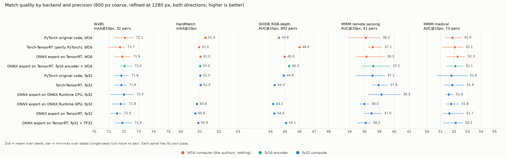
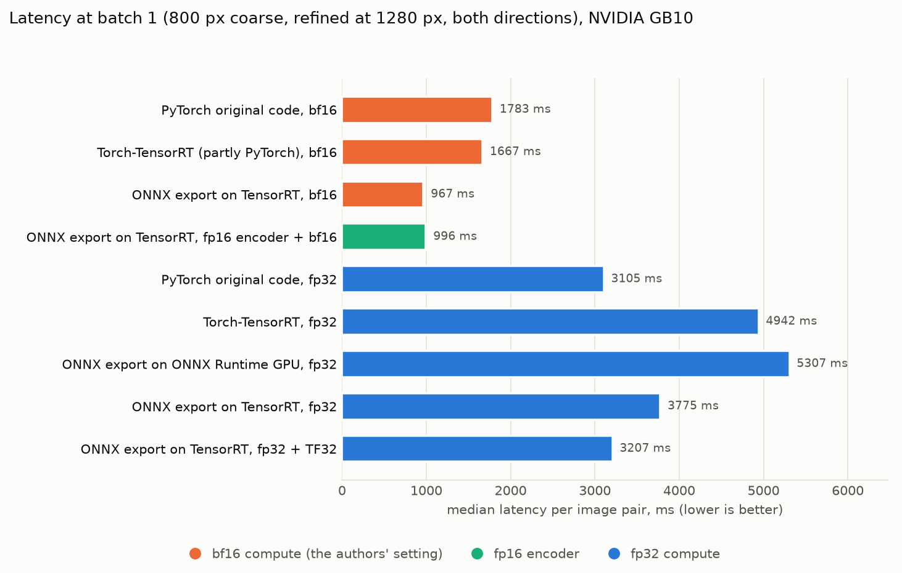
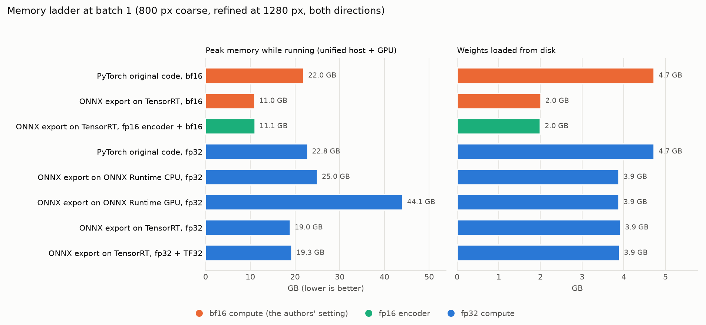
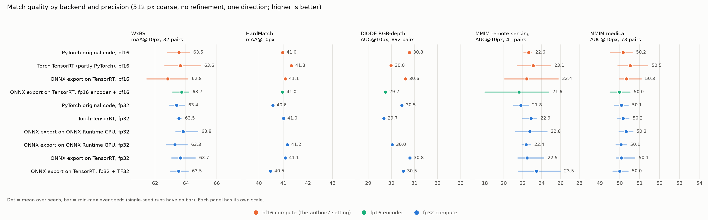
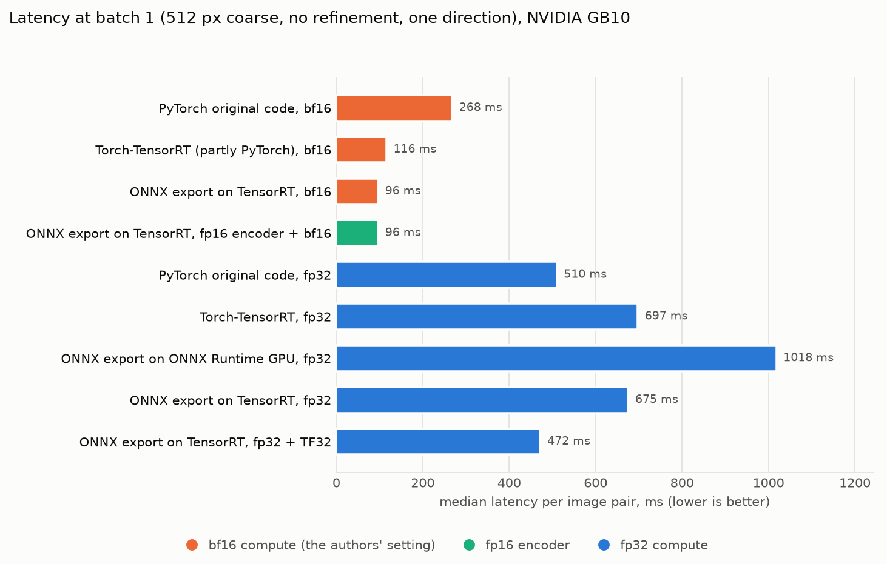
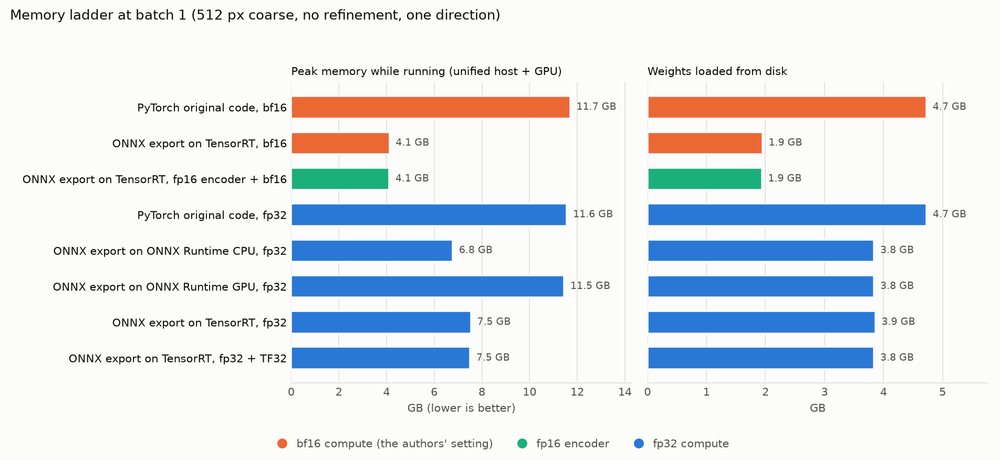

# RoMa-Ω: ONNX and TensorRT deployment

Export of the full RoMa-Ω matching pipeline (frozen VGGT-Ω encoder, coarse matcher
and both refinement passes) to ONNX and TensorRT, with an accuracy, latency and
memory comparison against the original PyTorch code.

> **This is deployment code for an existing model, not a new one.** The model, the
> weights and the paper are the work of the RoMa-Ω authors:
> *RoMa-Ω: What Feed-Forward 3D Models Know About Image Matching*, by David
> Nordström, Xinyue Zhang, Thibaut Loiseau, Vincent Lepetit and Fredrik Kahl
> ([paper](https://arxiv.org/abs/2609.09507),
> [original repository](https://github.com/davnords/RoMa-Omega)). See
> [Credits](#credits).

This repository contains only the deployment code, in [`deployment/`](deployment/).
The original RoMa-Ω code is not copied here: it is included unmodified as a git
submodule ([`RoMa-Omega/`](https://github.com/davnords/RoMa-Omega), pinned to
commit `24c693a`).

**Result in one line:** with the authors' default settings, the bf16 TensorRT
engines run the full pipeline in 967 ms per image pair on an NVIDIA GB10 (DGX
Spark), 1.8x faster than the original PyTorch code in the same precision
(1,783 ms), with half the peak memory, and match quality within seed noise on five
datasets.

| | |
|---|---|
| Hardware | NVIDIA DGX Spark (GB10, aarch64, CUDA 13, unified memory) |
| Software | torch 2.13.0+cu130, onnx 1.23.2, onnxscript 0.7.2, onnxruntime-gpu 1.31.1, TensorRT 11.4.0.106; Torch-TensorRT 2.13.0 with TensorRT 11.0.0.114 in a separate environment |
| Upstream | RoMa-Omega `24c693a`, vggt-omega submodule `39a0cb8` |
| Export | dynamo (`torch.export`) ONNX exporter, opset 18, static shape, batch 1 |

## What is exported

The pipeline is exported as four static-shape graphs, run one after another:

| Graph | Input | Output |
|---|---|---|
| `encoder.onnx` | both images at the coarse size | two VGGT-Ω feature maps |
| `matcher.onnx` | the feature maps | coarse warp and overlap, on a grid a quarter of the image size |
| `refiner.onnx` (first pass) | both images at the coarse size, the coarse warp | warp and confidence at the coarse size |
| `refiner.onnx` (second pass) | both images at the refinement size, the first-pass warp | warp and confidence at the refinement size |

Each refinement pass holds the VGG19-BN fine features and the three convolutional
refiners (patch sizes 4, 2 and 1). Image resizing, confidence mapping and match
sampling stay in the authors' Python code; only the network is swapped.

Every setting of the authors' pipeline is configurable, with their default
(`precise`) setting as the default:

| Setting | Flag | Default | Authors' `fast` setting |
|---|---|---|---|
| Coarse resolution | `--coarse-size` | 800 | 512 |
| Matching direction | `--direction` | `both` (A→B and B→A) | `ab` |
| Refinement | `--refiners` | `on` | `off` |
| Second refinement pass | `--refine-size` | 1280 | `none` |
| Matches sampled per pair | `--num-corresp` (evaluation) | 5000 | 5000 |

The weights on disk are fp32 and the authors compute under bf16 autocast (PyTorch's
automatic mixed precision). Three precisions are exported: `fp32`, `bf16` (the
authors' compute precision) and `fp16`.

## How to read the tables

- **Model** is what gets loaded. *PyTorch checkpoint* is the authors' original
  model; *ONNX export* is the set of `.onnx` graphs produced by this repository.
- **Runs on** is the software that executes it. *PyTorch, original code* is the
  authors' own code, unchanged. *Torch-TensorRT* compiles the PyTorch modules with
  TensorRT directly, with no ONNX file; parts it cannot compile stay in PyTorch (see
  the notes). *ONNX Runtime* runs the ONNX graphs as they are. *TensorRT* compiles
  the ONNX graphs into optimised GPU engines.
- **Accuracy:** WxBS and HardMatch are the authors' benchmarks (mAA@10px); DIODE
  and MMIM follow the [MINIMA](https://github.com/LSXI7/MINIMA) homography protocol
  (AUC@10px). Values are mean ± standard deviation over 5 seeds where a deviation is
  shown, otherwise one seed. The seed changes match sampling and the robust
  estimator, not the network. Higher is better.
- **Latency and memory:** batch 1, one real image pair, each variant in a fresh
  process on an idle GPU; median of 50 runs after 10 warm-up runs, or of 5 runs for
  variants slower than 3 s per pair. The network only: no image loading, resizing or
  match sampling. Peak memory is the largest drop in system `MemAvailable` while the
  process runs, because host and GPU share memory on the GB10.

## Full pipeline (the authors' default setting)

800 px coarse stage, refined at 800 px and again at 1280 px, both matching
directions, 5,000 matches per pair. This is the setting the authors' published
numbers use.

### Accuracy

<!-- table:acc:c800x800_r1280x1280_bidir -->
| Model | Runs on | Precision | WxBS | HardMatch | DIODE RGB-depth | MMIM remote | MMIM medical |
|---|---|---|---|---|---|---|---|
| PyTorch checkpoint | PyTorch, original code | bf16 | 72.07 ± 0.54 | 51.28 | 44.58 | 36.19 ± 1.86 | 51.89 ± 0.49 |
| PyTorch checkpoint | PyTorch, original code | fp32 | 71.83 ± 0.40 | 51.02 | 44.91 | 37.08 ± 1.53 | 51.80 ± 0.88 |
| PyTorch checkpoint | PyTorch, original code, fp16 autocast | fp16 | 3.26 ± 0.00 (NaN) | not run | not run | 1.62 ± 1.97 (NaN) | 0.00 ± 0.00 (NaN) |
| PyTorch checkpoint | Torch-TensorRT | bf16 | 71.74 ± 0.45 | 50.96 | 46.00 | 37.11 ± 0.71 | 52.06 ± 0.77 |
| PyTorch checkpoint | Torch-TensorRT | fp32 | 71.82 ± 0.34 | 51.04 | 44.29 | 37.89 ± 0.89 | 51.87 ± 0.67 |
| ONNX export | ONNX Runtime, CPU | fp32 | 72.01 ± 0.57 | not run | not run | 38.29 ± 1.84 | 51.60 ± 0.20 |
| ONNX export | ONNX Runtime, GPU | fp32 | 71.78 ± 0.38 | 50.85 | 44.18 | 36.00 ± 0.47 | 51.79 ± 0.41 |
| ONNX export | TensorRT | fp32 | 71.55 ± 0.29 | 50.76 | 44.26 | 36.95 ± 0.88 | 51.66 ± 0.61 |
| ONNX export | TensorRT, TF32 on | fp32 | 71.90 ± 0.40 | 50.91 | 45.07 | 36.18 ± 0.66 | 52.12 ± 0.55 |
| **ONNX export** | **TensorRT** | **bf16** | 71.89 ± 0.38 | 51.03 | 44.97 | 36.28 ± 1.44 | 52.26 ± 0.62 |
| ONNX export | TensorRT, fp16 encoder + bf16 rest | fp16/bf16 | 72.05 ± 0.31 | 51.01 | 45.28 | 37.20 ± 1.42 | 52.09 ± 0.59 |
| ONNX export | TensorRT, all fp16 | fp16 | 3.26 ± 0.00 (NaN) | 2.16 (NaN) | 0.00 (NaN) | 0.00 ± 0.00 (NaN) | 0.00 ± 0.00 (NaN) |
<!-- /table -->



- Every working export agrees with the original PyTorch code within the seed spread
  on the three multi-seed datasets. HardMatch and DIODE are single-seed, so
  differences there (up to about 1.5 points on DIODE) cannot be separated from noise
  with this data.
- The PyTorch bf16 row reproduces the authors' published WxBS (71.98 in their
  README) and HardMatch (51.10) numbers.
- ONNX Runtime on CPU takes about 37 s per pair here, so it was run only on the
  three small datasets.

### Latency and memory at batch 1

Per stage: encoder / matcher / refinement at the coarse size / refinement at
1280 px. The PyTorch rows time the authors' single `forward` call, so they have no
per-stage split.

<!-- table:rt:c800x800_r1280x1280_bidir -->
| Model | Runs on | Precision | Latency (ms) | Per stage (ms) | Peak memory (GB) | Weights on disk (GB) |
|---|---|---|---|---|---|---|
| PyTorch checkpoint | PyTorch, original code | bf16 | 1,783 | — | 22.0 | 4.7 |
| PyTorch checkpoint | PyTorch, original code | fp32 | 3,105 | — | 22.8 | 4.7 |
| PyTorch checkpoint | Torch-TensorRT | bf16 | 1,667 | 316 / 91 / 345 / 925 | (see note) | 4.7 |
| PyTorch checkpoint | Torch-TensorRT | fp32 | 4,942 | 2,650 / 523 / 611 / 1,140 | (see note) | 4.7 |
| ONNX export | ONNX Runtime, CPU | fp32 | 36,694 | 19,867 / 4,824 / 3,193 / 8,370 | 25.0 | 3.9 |
| ONNX export | ONNX Runtime, GPU | fp32 | 5,307 | 2,958 / 606 / 477 / 1,286 | 44.1 | 3.9 |
| ONNX export | TensorRT | fp32 | 3,775 | 2,477 / 506 / 230 / 567 | 19.0 | 3.9 |
| ONNX export | TensorRT, TF32 on | fp32 | 3,207 | 2,073 / 410 / 188 / 463 | 19.3 | 3.9 |
| **ONNX export** | **TensorRT** | **bf16** | **967** | 310 / 60 / 186 / 448 | **11.0** | 2.0 |
| ONNX export | TensorRT, fp16 encoder + bf16 rest | fp16/bf16 | 996 | 303 / 59 / 198 / 438 | 11.1 | 2.0 |
| ONNX export | TensorRT, all fp16 (output is NaN) | fp16 | 770 | 295 / 55 / 124 / 311 | 10.9 | 2.0 |
<!-- /table -->




- **The refiners are now most of the time.** In bf16 TensorRT, the two refinement
  passes take 634 of 967 ms; the encoder takes 310 ms.
- **Memory ladder:** fp32 to bf16 halves the engines on disk (3.9 to 2.0 GB) and
  peak memory falls from 19.0 to 11.0 GB. fp16 gives no usable gain over bf16.
- **fp32 is slow everywhere at this resolution.** fp32 TensorRT is slower than fp32
  PyTorch (3,775 against 3,105 ms); the fp32 encoder alone takes about 2.5 s in
  TensorRT. The cause was not investigated.
- **ONNX Runtime on GPU** peaks at 44 GB, more than any other variant. It logs a
  warning that `ScatterND` without reduction is only correct for unique indices; its
  output still matches PyTorch fp32 to 0.04 px on the validation pair (below).
- **Torch-TensorRT** compiled only the encoder in bf16 (the matcher hits the missing
  bf16 `ConvTranspose`; the refiners fail with an error that was not investigated),
  and everything except the 1280 px refiner in fp32. Those parts run in PyTorch. It
  also compiles inside the measured process, so its memory figure is a build
  footprint and is left out.
- The PyTorch memory figures include the 1.1-billion-parameter encoder loaded in
  fp32.

### Numerical agreement on one pair

`validate_pipeline.py` compares every variant's final warp with PyTorch fp32 on one
WxBS pair, in pixels of the 1280×1280 output, over the pixels PyTorch considers
overlapping (mean / median).

| Variant | A→B (px) | B→A (px) |
|---|---|---|
| PyTorch, original code, bf16 | 0.21 / 0.11 | 1.98 / 0.34 |
| ONNX Runtime GPU, fp32 | 0.04 / 0.03 | 0.39 / 0.04 |
| TensorRT, fp32 | 0.04 / 0.03 | 0.36 / 0.04 |
| TensorRT, fp32 + TF32 | 0.08 / 0.04 | 2.26 / 0.13 |
| TensorRT, bf16 | 0.27 / 0.13 | 4.20 / 0.29 |
| TensorRT, fp16 encoder + bf16 | 0.21 / 0.13 | 3.41 / 0.43 |
| Torch-TensorRT, fp32 | 0.03 / 0.02 | 0.40 / 0.04 |
| Torch-TensorRT, bf16 | 0.24 / 0.12 | 2.96 / 0.39 |

The fp32 exports differ from fp32 PyTorch by less than the authors' own bf16
setting does. Means in the B→A direction are pulled up by a few pixels the model
itself is unsure about; maximum errors there reach tens to hundreds of pixels even
between two fp32 backends. That is why the dataset scores, not single-pixel
maxima, are the test of an export.

## Coarse matcher only (the authors' `fast` setting)

512 px coarse stage, one direction, no refinement: two graphs (encoder and
matcher). This was the first export and is kept for comparison. Up to 2,000
matches per pair: 5,000 do not fit the 128×128 coarse grid, because the authors'
sampler draws four times the requested count without replacement.

### Accuracy

<!-- table:acc:c512x512_ab_coarse -->
| Model | Runs on | Precision | WxBS | HardMatch | DIODE RGB-depth | MMIM remote | MMIM medical |
|---|---|---|---|---|---|---|---|
| PyTorch checkpoint | PyTorch, original code | bf16 | 63.55 ± 0.62 | 40.97 | 30.78 | 22.63 ± 0.34 | 50.17 ± 0.45 |
| PyTorch checkpoint | PyTorch, original code | fp32 | 63.40 ± 0.38 | 40.57 | 30.46 | 21.80 ± 0.71 | 50.08 ± 0.24 |
| PyTorch checkpoint | PyTorch, original code, fp16 autocast | fp16 | 3.26 ± 0.00 (NaN) | not run | not run | 0.31 ± 0.70 (NaN) | 0.00 ± 0.00 (NaN) |
| PyTorch checkpoint | Torch-TensorRT | bf16 | 63.64 ± 0.84 | 41.33 | 29.98 | 23.12 ± 1.35 | 50.52 ± 0.57 |
| PyTorch checkpoint | Torch-TensorRT | fp32 | 63.54 ± 0.11 | 41.01 | 29.68 | 22.88 ± 0.56 | 50.17 ± 0.22 |
| ONNX export | ONNX Runtime, CPU | fp32 | 63.83 ± 0.56 | not run | not run | 22.75 ± 1.35 | 50.33 ± 0.27 |
| ONNX export | ONNX Runtime, GPU | fp32 | 63.29 ± 0.54 | 41.16 | 30.04 | 22.37 ± 0.37 | 50.06 ± 0.24 |
| ONNX export | TensorRT | fp32 | 63.66 ± 0.58 | 41.07 | 30.81 | 22.45 ± 1.07 | 50.08 ± 0.38 |
| ONNX export | TensorRT, TF32 on | fp32 | 63.53 ± 0.43 | 40.48 | 30.51 | 23.45 ± 1.64 | 50.00 ± 0.34 |
| **ONNX export** | **TensorRT** | **bf16** | 62.83 ± 0.97 | 41.07 | 30.61 | 22.42 ± 2.44 | 50.33 ± 0.44 |
| ONNX export | TensorRT, fp16 encoder + bf16 rest | fp16/bf16 | 63.72 ± 0.46 | 40.97 | 29.75 | 21.62 ± 2.45 | 49.99 ± 0.40 |
| ONNX export | TensorRT, all fp16 | fp16 | 3.26 ± 0.00 (NaN) | 2.38 (NaN) | 0.00 (NaN) | 0.00 ± 0.00 (NaN) | 0.00 ± 0.00 (NaN) |
<!-- /table -->



### Latency and memory at batch 1

Per stage: encoder / matcher. For the PyTorch rows the matcher time is the total
minus a separately timed encoder.

<!-- table:rt:c512x512_ab_coarse -->
| Model | Runs on | Precision | Latency (ms) | Per stage (ms) | Peak memory (GB) | Weights on disk (GB) |
|---|---|---|---|---|---|---|
| PyTorch checkpoint | PyTorch, original code | bf16 | 268 | 243 / 25 | 11.7 | 4.7 |
| PyTorch checkpoint | PyTorch, original code | fp32 | 510 | 442 / 68 | 11.6 | 4.7 |
| PyTorch checkpoint | Torch-TensorRT | bf16 | 116 | 89 / 23 | (see note) | 4.7 |
| PyTorch checkpoint | Torch-TensorRT | fp32 | 697 | 590 / 98 | (see note) | 4.7 |
| ONNX export | ONNX Runtime, CPU | fp32 | 8,316 | 7,113 / 1,210 | 6.8 | 3.8 |
| ONNX export | ONNX Runtime, GPU | fp32 | 1,018 | 879 / 156 | 11.5 | 3.8 |
| ONNX export | TensorRT | fp32 | 675 | 575 / 98 | 7.5 | 3.9 |
| ONNX export | TensorRT, TF32 on | fp32 | 472 | 402 / 70 | 7.5 | 3.8 |
| **ONNX export** | **TensorRT** | **bf16** | **96** | 84 / 12 | **4.1** | 1.9 |
| ONNX export | TensorRT, fp16 encoder + bf16 rest | fp16/bf16 | 96 | 84 / 12 | 4.1 | 1.9 |
| ONNX export | TensorRT, all fp16 (output is NaN) | fp16 | 97 | 84 / 12 | 3.9 | 1.9 |
<!-- /table -->




- Torch-TensorRT bf16 compiled the encoder only; the matcher runs in PyTorch.
- The PyTorch memory figures include the refiner weights, which the authors' code
  loads even when only the coarse stage runs.

## Unsupported operations and workarounds

| Problem | Where | Workaround |
|---|---|---|
| bf16 autocast is hard-coded in the DPT head and VGG features, so an fp32 trace still contains bf16 | upstream `dpt.py`, `features.py` | `common.tracing_context` replaces `torch.autocast` while tracing (disabled for fp32, forced to fp16 for fp16); no upstream edit |
| TensorRT 11 has no FP16/INT8 builder flags; engines are always strongly typed | TensorRT | precision is set at export time; one ONNX graph per precision |
| TF32 is on by default and moves encoder features by 0.8% | TensorRT | `build_trt.py --no-tf32` (2e-5 relative error); both builds are benchmarked |
| No bf16 `ConvTranspose` implementation; wrapping it in fp32 casts fails because TensorRT folds the casts away | TensorRT, matcher DPT head | `onnx_rewrites.py` rewrites each `ConvTranspose` with kernel = stride as a 1×1 `Conv` + `DepthToSpace`; identical output on the fp32 graph (max difference 0.0) |
| In 16-bit refiner graphs the exporter leaves 112 folded `Conv`/`BatchNormalization` constants in fp32 next to 16-bit inputs; TensorRT rejects mixed types | exporter, refiners | `onnx_rewrites.cast_constants_to_input_dtype` inserts a `Cast` on each |
| The refiners' local correlation samples all 49 window offsets in one `grid_sample`, a 3.9 GB intermediate at 1280 px; TensorRT spent about 1.5 s of 2.1 s per refinement pass on it | upstream `local_correlation.py` | the export traces an equivalent form that samples one offset at a time (`common.per_offset_local_corr`, swapped in during tracing only): same arithmetic, 7e-7 difference at function level, refinement pass about 4× faster. `--local-corr upstream` keeps the original form |
| IEEE fp16 overflows in the matcher (activations near 21,700 feed layers that exceed 65,504) and the output is NaN, in PyTorch and TensorRT alike | model | keep the matcher in bf16; the fp16 encoder is fine |
| Torch-TensorRT cannot compile some modules (bf16 matcher: same `ConvTranspose` gap; bf16 refiners and the fp32 1280 px refiner: errors not investigated) | Torch-TensorRT 2.13 | those modules stay in PyTorch; the result files record which |
| Torch-TensorRT 2.13 pins TensorRT 11.0 and would downgrade 11.4 | packaging | separate virtual environment |

The per-offset correlation is not bit-identical in the whole pipeline: the model
amplifies rounding differences in uncertain regions. In fp32 the TensorRT pipeline
that uses it still matches PyTorch to 0.04 px (mean, A→B), and the dataset scores
are within seed noise.

## Speed and accuracy trade-off

- **Use bf16 TensorRT.** It keeps the precision the model was released with, costs
  nothing measurable in accuracy, and is the fastest working configuration: 1.8×
  faster than the original code in the full pipeline, 2.8× for the coarse matcher
  alone.
- **fp32 buys nothing here:** same accuracy, about 4× slower than bf16 TensorRT
  and nearly twice the memory.
- **fp16 is not usable end to end** for this model. The hybrid (fp16 encoder, bf16
  for the rest) works but is no faster than all-bf16.
- **Refinement is the accuracy lever, and also the cost.** The full pipeline scores
  about 8 points higher on WxBS and 10 on HardMatch than the 512 px coarse matcher,
  at 10× the latency (967 against 96 ms in bf16 TensorRT). Coarse resolution and
  refinement were not varied separately, so how much of the gap each accounts for
  is not measured.
- **Next optimisation target:** the refinement passes, now two thirds of the bf16
  TensorRT time.

## Reproduce

All commands run from the root of this repository. Clone it with its submodules
(RoMa-Ω, and VGGT-Ω inside it):

```bash
git clone --recurse-submodules https://github.com/wc466/RoMa-Omega-ONNX.git
```

Setup (the environment is created inside the submodule, at `RoMa-Omega/.venv`; the
second command installs packages outside the upstream lock file):

```bash
uv sync --frozen --directory RoMa-Omega
```

```bash
uv pip install --python RoMa-Omega/.venv/bin/python onnx==1.23.2 onnxscript==0.7.2 onnxruntime-gpu==1.31.1 tensorrt-cu13==11.4.0.106 matplotlib
```

The VGGT-Ω checkpoint is gated on Hugging Face (`facebook/VGGT-Omega`,
`vggt_omega_1b_512.pt`); accept its licence, download it and save it as
`vggtomega.pt` in the root of this repository. The RoMa-Ω checkpoint downloads
automatically.

**Export** every graph of the pipeline, once per precision (repeat with `fp32` and
`fp16`):

```bash
RoMa-Omega/.venv/bin/python deployment/export_pipeline.py --precision bf16
```

**Build the TensorRT engines.** bf16 and fp16 with no flags; fp32 twice, with
`--no-tf32` (variant `trt_fp32`) and without (variant `trt_fp32_tf32`):

```bash
RoMa-Omega/.venv/bin/python deployment/build_pipeline_trt.py --precision bf16
```

```bash
RoMa-Omega/.venv/bin/python deployment/build_pipeline_trt.py --precision fp32 --no-tf32
```

Every graph and engine gets a `.provenance.json` sidecar (checkpoint hashes, the
three commit hashes, exporter, opset, workarounds applied).

**Validate** on one pair against PyTorch fp32:

```bash
RoMa-Omega/.venv/bin/python deployment/validate_pipeline.py
```

**Datasets** go under `data/` in the root of this repository. WxBS and HardMatch
are fetched as described in the upstream README. For the MINIMA protocol, clone
MINIMA into the root of this repository (`MINIMA/`, git-ignored), extract the DIODE
validation split to `data/DIODE/val`, clone the MMIM database
(`Multi-modality-image-matching-database-metrics-methods`) into `data/MMIM/`, then
render the DIODE depth maps:

```bash
RoMa-Omega/.venv/bin/python deployment/prepare_diode.py
```

**Accuracy** (small datasets, five seeds; then the large ones, one seed):

```bash
RoMa-Omega/.venv/bin/python deployment/eval_datasets.py --datasets wxbs,mmim_remote,mmim_medical --seeds 1,2,3,4,5 --variants torch_bf16,torch_fp32,torch_fp16,onnx_cpu_fp32,onnx_gpu_fp32,trt_fp32,trt_fp32_tf32,trt_bf16,trt_fp16enc_bf16,trt_fp16
```

```bash
RoMa-Omega/.venv/bin/python deployment/eval_datasets.py --datasets hardmatch,diode --seeds 1 --variants torch_bf16,torch_fp32,onnx_gpu_fp32,trt_fp32,trt_fp32_tf32,trt_bf16,trt_fp16enc_bf16,trt_fp16
```

**Latency and memory**, then **figures**:

```bash
RoMa-Omega/.venv/bin/python deployment/benchmark_runtime.py
```

```bash
RoMa-Omega/.venv/bin/python deployment/make_figures.py
```

**Other settings:** every command above takes the pipeline flags. For the coarse
matcher only, as in the second set of tables, add
`--coarse-size 512 --refine-size none --direction ab --refiners off`, plus
`--num-corresp 2000` for `eval_datasets.py`.

**Torch-TensorRT** variants (`torchtrt_fp32`, `torchtrt_bf16`) run
`eval_datasets.py` and `benchmark_runtime.py` from a second environment holding
torch 2.13, `torch-tensorrt` 2.13.0 and upstream installed with
`pip install -e RoMa-Omega`; pass `--variants torchtrt_fp32,torchtrt_bf16` (and
`--append` for `benchmark_runtime.py`).

Raw results are in `deployment/results/`: one JSON per dataset, configuration and
variant (with per-seed and per-scene numbers), one runtime file and one validation
file per configuration.

## Code map

| File | Role |
|---|---|
| `pipeline.py` | `PipelineConfig`: the settings above, graph and result naming |
| `common.py` | stage wrappers (`EncoderWrapper`, `MatcherWrapper`, `RefinerStageWrapper`), precision and correlation swaps used during tracing, provenance |
| `export_encoder.py`, `export_matcher.py`, `export_refiner.py` | export one graph each |
| `export_pipeline.py` | export every graph of a configuration |
| `onnx_rewrites.py` | post-export graph fixes |
| `build_trt.py`, `build_pipeline_trt.py` | ONNX to TensorRT, one graph or a whole configuration |
| `trt_common.py` | engine runner using PyTorch GPU tensors as buffers |
| `matchers.py` | variants and the graph pipeline that replaces the model's `forward` |
| `validate_pipeline.py` | one pair, every variant against PyTorch fp32 |
| `validate_encoder.py`, `validate_matcher.py`, `validate_trt.py` | earlier per-graph checks for the coarse matcher |
| `eval_datasets.py`, `benchmarks_minima.py`, `prepare_diode.py` | accuracy on the five datasets |
| `benchmark_runtime.py` | latency and memory |
| `make_figures.py` | figures from the result files |

The stage wrappers contain no new computation: they call the authors' own
submodules in the same order and only cut the pipeline at tensor boundaries.
Chained in PyTorch, they reproduce the original model's output exactly (difference
0.0).

## Deviations and limitations

- **DIODE is not guaranteed comparable to MINIMA's published numbers.** The public
  archive has no depth PNGs and no pair list, so depth is rendered with the DIODE
  devkit colour map and pairs are enumerated from disk (892 pairs); homographies use
  MINIMA's sampler and per-file seeding. MMIM uses MINIMA's test lists unchanged.
- MINIMA's metric code is ported (`benchmarks_minima.py`) because the original does
  not run on current NumPy/Python.
- Static shape and batch 1 only. Dynamic shapes, INT8 and the RoMa v2 / LoMa
  baselines from the original plan are not done.
- The coarse-only results were produced by an earlier version of the harness (with
  `_coarse` variant names, recorded in each file as `variant_name_before_rename`).
  Four of its cells were re-run with the current code and reproduce exactly; the
  rest were not re-run.

## Credits

All credit for the model goes to the RoMa-Ω authors (Chalmers University of
Technology; Mobile Perception Lab, ShanghaiTech University; LIGM, École des Ponts,
Univ. Gustave Eiffel, CNRS). RoMa-Ω builds on
[RoMa v2](https://github.com/Parskatt/RoMaV2) and uses the
[VGGT-Ω](https://github.com/facebookresearch/vggt-omega) encoder from Meta. If you
use this deployment code, please cite their paper:

```bibtex
@inproceedings{nordstrom2026romaomega,
      title={RoMa-$\Omega$: What Feed-Forward 3D Models Know About Image Matching},
      author={David Nordström and Xinyue Zhang and Thibaut Loiseau and Vincent Lepetit and Fredrik Kahl},
      booktitle={Proceedings of the European Conference on Computer Vision (ECCV) Workshops},
      year={2026}
}
```

This repository is not affiliated with or endorsed by the authors.

## Licences

- **No weights, ONNX graphs or engines are in this repository.** The VGGT-Ω encoder
  is under the FAIR Noncommercial Research License, and an exported graph contains
  those weights; `deployment/artifacts/` is git-ignored. Check that licence before
  redistributing anything built here.
- The RoMa-Ω README states MIT, but that repository has no LICENSE file. This
  repository does not redistribute its code; it links to it as a submodule.
- MINIMA is Apache-2.0; `benchmarks_minima.py` ports its metric code and imports its
  homography sampler. The DIODE devkit (depth colour map) is MIT. The MMIM database
  repository carries no licence; it is used for evaluation only and not redistributed.
